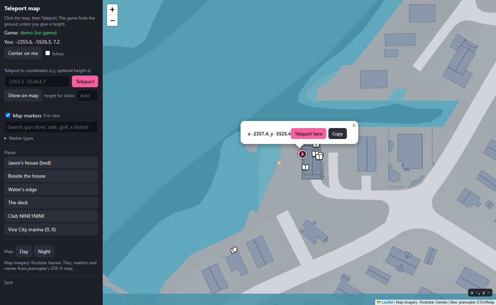
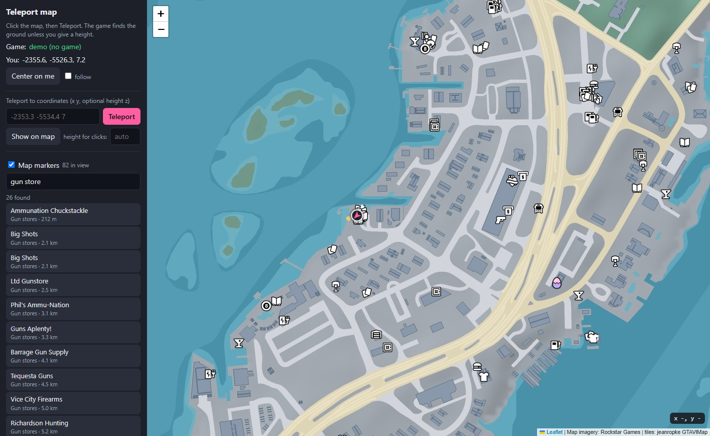
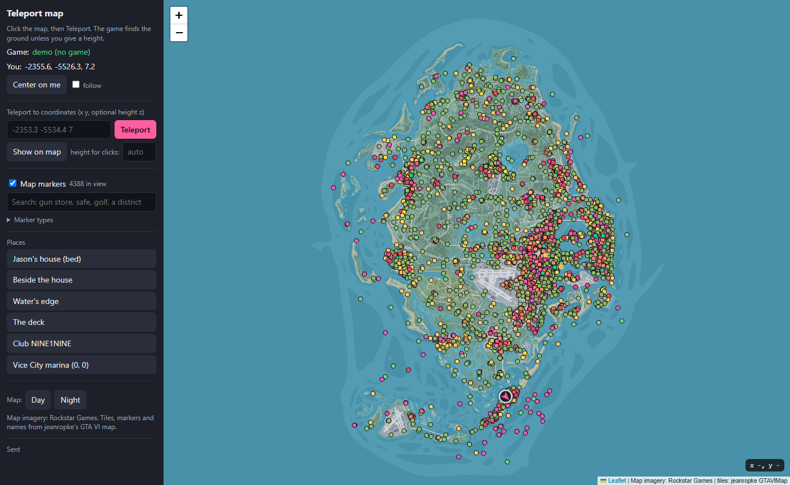
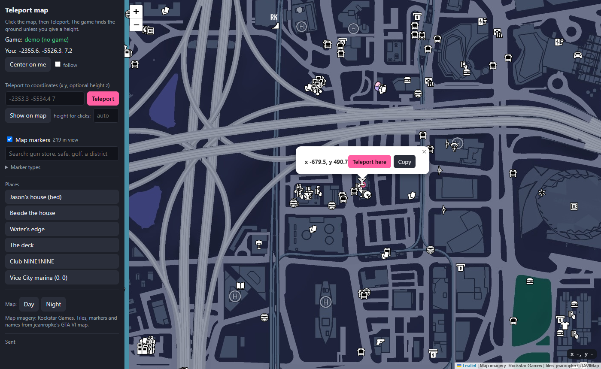

# VIctory teleport map

A click-to-teleport map for GTA VI running under a VIctory build with the mod commands turned on.
It is one small Python server and one web page. The page shows the community GTA VI map with the
**game's own coordinates** under your mouse, your player's live position, the community map's markers
(shops, safes, activities, vehicles and more, about 15,700 of them) and a search over their names. Click a
spot or a marker, press **Teleport here**, and the game puts you there. It can also run with no internet
connection from a saved copy of the map.



## What you need

- **Python 3.8 or later.** Only the standard library is used, so there is nothing to install.
- **A web browser, and an internet connection or an offline copy.** Online, the page loads
  [Leaflet](https://leafletjs.com/) from cdnjs and the map tiles, markers, names and icons from
  [jeanropke's GTA VI map](https://jeanropke.github.io/GTAVIMap/). To play without internet, save a copy once
  (see [Offline](#offline)).
- **A VIctory build that has the mod commands** (`VICTORY_MOD=1`). That code lives in a VIctory fork
  (branch `test/mod1`) and is not part of this repository. Any build that reads and writes the two files
  described under [How it talks to the game](#how-it-talks-to-the-game) works.

## Try it without the game

```powershell
python modmap.py --demo --open
```

This opens http://127.0.0.1:8766/ with a pretend player standing on the deck of Jason's house. Teleports
move the pretend player and are printed in the console. Nothing is written to disk.

## Use it with the game

1. Pick two file paths: one for commands to the game, one for the game's status. Any folder works.
2. Start the game from a PowerShell window with the mod turned on and those two paths set:

   ```powershell
   $env:VICTORY_MOD = "1"
   $env:VICTORY_MOD_FILE = "C:\victory\mod.txt"
   $env:VICTORY_MOD_STATUS = "C:\victory\status.txt"
   # now start the game with your VIctory build as usual, from this same window
   ```

3. In a second window, start the map with the same two paths:

   ```powershell
   python modmap.py --mod-file "C:\victory\mod.txt" --status-file "C:\victory\status.txt" --open
   ```

4. Once you are in control of your character, the side bar says **Game: running** and a pink arrow shows
   where you are and which way you face. If it says **not running**, the status file is missing or older
   than 5 seconds: check that `VICTORY_MOD=1` was set and that both programs use the same paths.

Options: `--port <n>` (default 8766), `--open` (open the page in your default browser), `--demo`, `--online` (ignore an offline copy), `--offline-dir <folder>`.

## Using the page

| You want to | Do this |
|---|---|
| Teleport to a spot | Click the map, then **Teleport here**. The game finds the ground there. |
| Teleport onto a roof or a deck | Type a height in **height for clicks** first, then click and teleport. |
| Teleport to exact coordinates | Type `x y` or `x y z` in the box and press **Teleport**. **Show on map** only shows the spot. |
| Find yourself | **Center on me**; tick **follow** to keep the map on you. |
| Go to a saved place | Press a button under **Places**, then **Teleport here**. |
| Find a place by name | Type in the search box (e.g. `gun store`, `safe`, `golf`, `vice beach`). Results are sorted by distance from you; click one to go there. Saved places and districts come first. |
| Teleport to a marker | Click it. **Teleport here** puts you 1 m above the marker's own height (right for shops and interiors); **On the ground** lets the game find the ground instead. |
| Show or hide markers | Untick **Map markers**. **Marker types** lists the 47 groups with their counts; tick the ones you want. **Default** shows everything except the vehicle-model groups. |
| See the night map | **Night** (and **Day** to go back). |
| Read coordinates | Move the mouse: the box at the bottom right shows game `x, y`. **Copy** in the popup copies them. |
| Link to a spot | Add `#x,y[,zoom][,pin][,night][,q=search]` to the address, e.g. `http://127.0.0.1:8766/#-679.5,490.7,16,pin`. `pin` opens the teleport popup there; `q=gun%20store` fills in the search. |

Every teleport the page sends is listed under **Sent**. The places are in `map.html` (the `PLACES` list);
add your own there. Your marker settings are remembered in the browser.

Up close the markers show their icons; zoomed out, or with more than 400 in view, they are coloured dots
(one colour per group, as in the **Marker types** list). Hover for a name.







## Offline

Save a copy of everything the page loads from the web, once, while you have internet:

```powershell
python download_offline.py
```

It saves the day and night maps up to zoom 15 (about 44,000 small tiles), the marker lists, names and icons,
and Leaflet into the `offline` folder next to the script. From then on `modmap.py` uses that copy by itself
(its first line says `offline copy`), and the page works with no connection. Zooming in past the saved level
enlarges the last saved tiles.

| Option | What it does |
|---|---|
| `--dry-run` | Only counts what it would fetch. |
| `--max-zoom 16` | Sharper close-ups: about 175,000 tiles for both layers (zoom 17, the web map's best, is 700,000). |
| `--layers day` | The day map only, half the tiles. |
| `--refresh-data` | Fetches the marker lists and names again; the community map adds to them over time. |
| `--workers <1-8>` | Downloads at a time (default 4; please keep it low, the tiles come from a community site's CDN). |

If it is stopped, run it again: it skips what it already has. To use the web again while a copy exists, start
the server with `--online`. The copy holds Rockstar Games' map imagery and the community map's data, so it is
for your own use: `offline/` is in `.gitignore`; do not commit or share it.

## How it talks to the game

Two plain text files, nothing else.

**Commands (the mod file, `VICTORY_MOD_FILE`).** The map appends one line per teleport:

```
teleport -2353.31 -5534.35 7.00
teleport -679.48 490.71
```

`teleport x y z` jumps to that position; `teleport x y` lets the game find the ground (a far jump waits
until the area has loaded). The game reads new lines once a frame. The map only ever sends `teleport`;
the mod build understands more commands, which you can append to the same file by hand.

**Status (the status file, `VICTORY_MOD_STATUS`).** The game rewrites it twice a second as `key=value`
lines. The map reads these keys:

```
game=running
updated_unix_ms=1795748599942
x=-2355.60
y=-5526.30
z=7.20
heading_deg=351
in_vehicle=0
```

The game counts as running when `game=running` and `updated_unix_ms` is less than 5 seconds old.
Other keys (health, wanted level, clock, weather) are ignored.

**Coordinates.** Game `x` grows to the east and `y` to the north, in metres. The map uses the same
projection as the community map's game-data markers: one zoom-8 Web Mercator tile covers 24576 game
units, with tile (127, 127) starting at game x = -15872, y = 13312. See `gameToLatLng` in `map.html`.

## Safety

- The server listens on `127.0.0.1` only, so other computers cannot reach it.
- Each start makes a new random key that is written into the page it serves. A teleport without that key,
  or from a page on another site, is refused, so a web page you visit cannot send commands to your game.
- It accepts only `teleport` with two or three finite numbers below 100000, and writes only when the game
  is running. It never reads or changes game files.
- With an offline copy it serves only the image, JSON, script and style files inside the `offline` folder.
- Marker names come from another site, so the page inserts them as plain text, never as HTML.

## Credits

- Map tiles and imagery: Rockstar Games, served by [jeanropke's GTA VI map](https://jeanropke.github.io/GTAVIMap/).
- Markers, their names, groups and icons, and the district names: [jeanropke's GTA VI map](https://jeanropke.github.io/GTAVIMap/).
  This repository holds none of their data. Your browser loads it from their site, as it does on their map,
  or from the offline copy you saved yourself. This project is not affiliated with them or with Rockstar Games.
- Map library: [Leaflet](https://leafletjs.com/) 1.9.4 (BSD-2-Clause), loaded from cdnjs.
- The game side: the VIctory compatibility layer and its forks.

Single player only.
